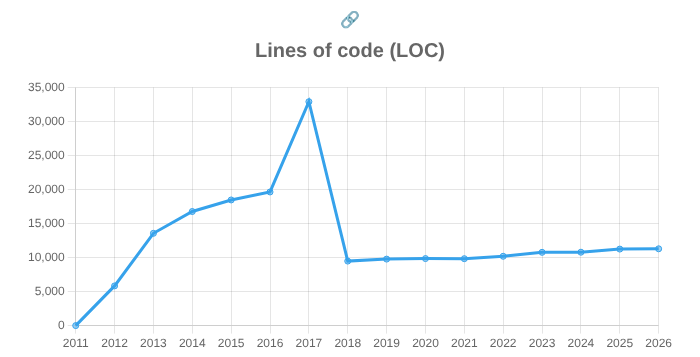

## 1. Repositório selecionado

https://github.com/psf/requests

Relatório gerado: [report_requests.html](report_requests.html) (dados brutos em [report_requests.csv](report_requests.csv)).

Comando utilizado (a opção `-f 2011` faz a análise cobrir todo o histórico do projeto, e não apenas os últimos 5 anos, que é o padrão):

```
$ gitevo -r python -f 2011 https://github.com/psf/requests
```

## 2. Gráfico selecionado

**Lines of code (LOC)**



## 3. Explicação

O gráfico mostra a quantidade de linhas de código Python do repositório `requests` ao longo do tempo. O GitEvo analisa um commit por ano (o primeiro commit de cada ano), então cada ponto é uma "foto" do repositório em janeiro daquele ano.

A curva tem três fases bem diferentes:

**1) Crescimento (2011–2016).** O ponto de 2011 é zero porque o primeiro commit do projeto (13/02/2011, *"first commit"*) continha apenas um `README`. Nos anos seguintes o código cresce rápido: ~5,8 mil linhas em 2012, ~13,5 mil em 2013 e chega a ~19,6 mil em 2016. É a fase em que a biblioteca ganha suas funcionalidades principais (sessões, adaptadores, autenticação, cookies etc.) e se torna o cliente HTTP mais popular do Python. Depois de 2014 o crescimento desacelera bastante, o que é esperado em uma biblioteca que já cobre o essencial.

**2) O pico de 2017 (~32,9 mil linhas).** Esse salto **não** veio de novas funcionalidades. O `requests` mantinha cópias das suas dependências dentro do próprio repositório, na pasta `requests/packages/` (prática chamada de *vendoring*). Em outubro de 2016 foi embutida também a biblioteca `idna` (commit `3c680cc1`, *"Vendor idna v2.1"*). Só o código embutido em janeiro de 2017 somava:

| Pacote embutido | Linhas |
|---|---|
| `urllib3` | ~7,2 mil |
| `chardet` | ~7,6 mil |
| `idna` | ~9,4 mil |

O `idna` sozinho explica quase todo o salto, e a maior parte dele é um único arquivo de dados, o `uts46data.py` (~7,3 mil linhas), que é uma tabela gigante de tuplas Unicode. Isso aparece em outro gráfico do relatório: o número de *tuples* vai de 439 para **9.037** em 2017 e depois volta para 471.

**3) A queda e a estabilidade (2018–2026).** Na versão **2.16.0 (26/05/2017)**, o `HISTORY.md` do projeto registra apenas: *"Unvendor ALL the things!"*. O commit `8e17600e` (*"delete packages"*) removeu 86 arquivos e **26.324 linhas** de uma vez, e o `urllib3`, o `chardet` e o `idna` passaram a ser dependências normais instaladas pelo `pip`. Por isso o LOC cai para ~9,5 mil em 2018 e o número de arquivos `.py` cai de 106 para 35. Desde então a curva fica quase plana: de ~9,5 mil para ~11,3 mil linhas em 8 anos, com pequenos aumentos, principalmente nos testes.

**Boas práticas.** A curva conta uma história positiva:

- A queda de 2018 é uma boa decisão de engenharia. Manter cópias de outras bibliotecas dentro do projeto deixa o repositório maior, atrasa correções de segurança (o `requests` só recebia uma correção do `urllib3` quando alguém atualizava a cópia) e esconde o tamanho real do sistema. O código "próprio" do `requests` nunca teve 33 mil linhas.
- A estabilidade depois de 2018 combina com o momento do projeto: segundo o guia de contribuição (`docs/dev/contributing.rst`), o `requests` está em *"perpetual feature freeze"* e os mantenedores o consideram *feature-complete*, priorizando estabilidade da API em vez de novas funcionalidades. Um crescimento lento e controlado é o que se espera de uma biblioteca madura da qual milhões de projetos dependem.
- A lição para quem analisa métricas: **LOC sozinho engana.** Sem olhar o histórico do git e a documentação, alguém poderia achar que o projeto "dobrou de tamanho" em 2017 e "perdeu 70% do código" em 2018, quando na verdade o código escrito pela equipe do `requests` mudou muito pouco nesse período.
